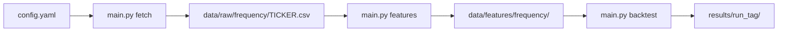
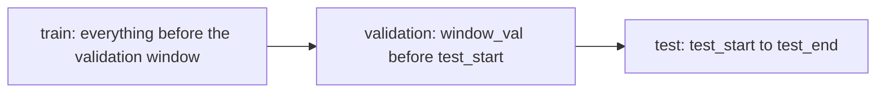
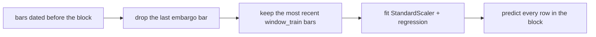
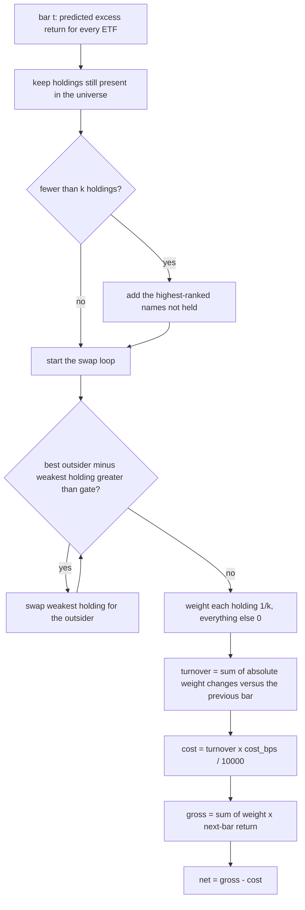

# systematic-trading-strategies

DSA5205 Project 2 - Designing, backtesting, and evaluating systematic trading strategies
using machine learning and quantitative financial analysis.

Nine US sector ETFs (XLB, XLE, XLF, XLI, XLK, XLP, XLU, XLV, XLY) are ranked every bar by a
predicted **excess return** (the asset's next-bar return minus the cross-sectional median).
The portfolio holds the top `k` at equal weight and only swaps a holding when the
challenger is expected to beat it by more than a gate that covers the trading cost. Models
are penalised linear regressions refitted walk-forward, scored on a validation window, and
evaluated once on the test period.

## How it works



Every bar a model is fitted on the past only, and the split is strictly chronological:



- **Validation** ranks model specifications (net Sharpe) and sweeps the gate.
- **Test** is scored once with the selected model and gate; nothing is tuned on it.
- Inside both windows the model is *refitted* every `refit_every` period:



The scaler lives inside the model pipeline, so it is refitted on each training window
rather than on the whole sample - no future mean or standard deviation leaks in.

## The `top_k` trading strategy

`k` names are held at equal weight, with a cost-aware rule for changing them. The whole
decision for one bar lives in `portfolio.build_portfolio`:



Why the gate exists:

| Gate | Behaviour | Turnover |
| --- | --- | --- |
| `0.0` | swap whenever the ranking changes | highest, pays the most cost |
| `2 * cost_bps / 10000` | swap only if the expected gain covers one round trip | moderate |
| large (e.g. `0.01`) | ignore small ranking changes | lowest, may lag the signal |

Because the gate is in *return* units, a value of `0.001` means "only swap if the newcomer is
expected to earn 0.1% more". The sweep in `portfolio.top_k.gate_sweep` replays the
validation window at each gate so the trade-off between turnover and Sharpe is visible
before the test period is touched.

Other details that matter:

- **Equal weight**, so no position sizing model is involved: the strategy is purely a
  selection and timing rule.
- **First bar is a full entry** (turnover = 1.0), so the cost model charges for building the
  book.
- **Weight drift inside a period is ignored**; turnover is measured between rebalances only.
- **Missing forward returns** for a held name are treated as zero, so a stale ticker cannot
  inject a return that was never tradable.
- The forward return used to score the portfolio is the next bar's close-to-close return, the
  same quantity the model predicts.

Adding another strategy only needs a function `f(preds, config) -> portfolio frame`
registered in `portfolio.STRATEGIES` plus a matching block in `config.yaml`; the pipeline
dispatches to it by name.

## Layout

```
main.py            command-line entry point (fetch | features | backtest)
config.yaml        local run settings (git-ignored; copy config.yaml.example)
data/              raw bars, feature tables and the alternative-data index (see data/README.md)
src/
  data.py          download and load prices, assemble the feature + label panel
  features.py      19 technical features and the feature/label correlation report
  labels.py        forward return and the cross-sectional excess-return target
  splits.py        date-window and sliding-period train/validation/test splits
  models.py        model specifications and walk-forward prediction
  portfolio.py     predicted returns -> equal-weight top-k portfolio with costs
  metrics.py       performance, benchmark, CAPM and forecast metrics
  plots.py         every figure written by the pipeline
  pipeline.py      model selection, test run and evaluation in one call
  utils/           paths, settings, validation, plotting, artifacts and CLI helpers
```

## Environment setup

This project uses [uv](https://docs.astral.sh/uv/) for dependency management. Install uv
first, then use the commands below from the project root.

```bash
# Install runtime and dev dependencies (creates .venv if missing)
uv sync

# Install runtime dependencies only, without the dev group
uv sync --no-dev
```

Runtime dependencies go into `[project].dependencies`; dev-only dependencies go into
`[dependency-groups].dev`.

```bash
uv add <package>                 # add a runtime dependency
uv add "<package>==<version>"    # add a pinned version
uv add --dev <package>           # add a dev-only dependency
uv remove <package>              # remove a runtime dependency
uv remove --dev <package>        # remove a dev-only dependency
```

> If you remove a dev dependency without `--dev`, uv looks in the runtime dependencies and
> will not find it.

Run anything inside that environment with `uv run python <script>.py`.

## Configuration

There are no command-line flags: every setting lives in `config.yaml`.

```bash
cp config.yaml.example config.yaml   # once; config.yaml is git-ignored
```

| Section | Controls |
| --- | --- |
| `seed` | random state for the global numpy seed and every model refit (default `5205`) |
| `data` | download date range |
| `features` | bar frequency (`daily`/`weekly`) and whether the Fear & Greed alternative data is included |
| `validation` | test window, rolling training window, validation window, refit cadence |
| `model` | `mode` is `single` or `selection`, with both a single spec and a selection grid declared |
| `portfolio` | `strategy: top_k` plus its `k`, `gate`, `cost_bps` and gate sweep |

Edit `config.yaml`, then re-run `uv run python main.py backtest`. Keep `validation.test_start`
at **2016 or later**: the panel starts in 2011 (the Fear & Greed index's first date) and the
default 3-year validation window needs history before it.

## Commands

All three commands take no flags; they read `config.yaml`, and all of them use
`features.frequency`.

```bash
# 1. Download the raw data at features.frequency (needs network access)
uv run python main.py fetch

# 2. Write the feature table and correlation report for that frequency
uv run python main.py features

# 3. Backtest on those features
uv run python main.py backtest
```

`fetch` downloads adjusted OHLCV bars for the sector ETFs and SPY for the configured bar
size, over `data.start_date`..`data.end_date` (currently **2004-01-01 through 2026-09-30**).
Daily bars land in `data/raw/daily/`; the weekly setting resamples the daily download into
Friday-ending bars (Open=first, High=max, Low=min, Close=last, Volume=sum) under
`data/raw/weekly/`. A trailing week whose Friday falls after the end date is dropped, so the
weekly series stops at the last complete week inside the range.

`features` builds one row per date and sector ETF with the 19 technical features in
`src/features.py`, plus `label_forward_return_1bar` (the next bar's close-to-close return).
Indicator lookbacks count bars, so a 14-bar RSI means 14 daily or 14 weekly observations, and
volatility is annualised with 252 or 52 periods per year. The Fear & Greed Index (0-100) and
SPY's one-bar return are aligned by carrying the latest observation dated on or before each
bar forward, so no future value leaks in. Outputs go to `data/features/<frequency>/`:

| File | Contents |
| --- | --- |
| `features.csv` | one row per date and ticker with the active features plus the label (git-ignored) |
| `feature_label_correlation.csv` | Pearson correlation of every feature with the label |
| `feature_label_correlation.png` | heatmap of that matrix |

The label is not part of `FEATURES`, so it stays separate from the predictor set. Initial
rows with insufficient lookback history are kept with missing values.

## Outputs

Each backtest prints the split sizes, the validation score for the configured model, the test
comparison twice (with and without SPY) alongside equal-weight, gross-versus-net strategy
stats, forecast metrics (out-of-sample R², RMSE, direction accuracy, rank IC) and CAPM
alpha/beta, then reports where the artifacts went.

Every run writes into its own `results/<run_tag>/` folder so configurations never overwrite
each other. The tag encodes the settings that change the numbers:

```
<frequency>_<fg|nofg>_roll<window_train>_val<window_val>_<refit>_<model>_<strategy><k>_g<gate>_c<cost>_<test years>

results/weekly_nofg_roll5y_val3y_mrefit_lasso_a0.0001_topk5_g0_c5_2024-2025/
```

`run_config.yaml` is not a copy of `config.yaml`: it records the resolved settings for that
run - the feature columns actually used, the expanded model specs (a grid is written out in
full), the training window in bars, and the portfolio parameters.

### Figures

| File | Shows |
| --- | --- |
| `cumulative_returns.png` | growth of $1: model (net) vs SPY vs equal-weight |
| `cumulative_returns_no_spy.png` | the same chart without SPY |
| `cumulative_returns_by_gate.png` | every gate in `gate_sweep` on the validation window |
| `cumulative_returns_by_gate_test.png` | every gate in `gate_sweep` on the test period |
| `drawdown.png` / `drawdown_no_spy.png` | drawdown from the running peak, with / without SPY |
| `gross_vs_net.png` | gross vs net growth of $1, and cumulative costs in bps |
| `sharpe_by_model.png` | validation net Sharpe for each configured model |
| `sharpe_by_period.png` / `sharpe_by_period_no_spy.png` | Sharpe ratio per calendar year, with / without SPY |
| `turnover_vs_gate.png` | annual turnover and net Sharpe against the gate |
| `coefficients.png` | standardised coefficients of the final model |
| `oos_r2.png` | out-of-sample R² by year and cumulatively |

### Tables

| File | Contents |
| --- | --- |
| `run_config.yaml` | resolved settings actually used by the run |
| `validation_ranking.csv` | one row per model spec, best validation net Sharpe first |
| `gate_sweep.csv` | annual turnover and net Sharpe per gate on validation |
| `gate_comparison_test.csv` | return, vol, Sharpe, drawdown and hit rate per gate on test |
| `comparison.csv` | the same stats for model, SPY and equal-weight |
| `comparison_no_spy.csv` | the same table without SPY |
| `strategy.csv` | gross and net stats, turnover and cost drag for the chosen model |
| `forecast.csv` | out-of-sample R², RMSE, direction accuracy, correlation and rank IC |
| `oos_r2_by_year.csv` | out-of-sample R² per calendar year |
| `capm.csv` | alpha, beta and the alpha t-statistic against SPY |
| `performance_by_period.csv` | calendar-year stats per strategy |
| `performance_by_period_no_spy.csv` | the same, without SPY |
| `coefficients.csv` | final model coefficients per feature |

`results/` is git-ignored; re-running the same configuration overwrites that folder, and a
different configuration creates a new one.

## Tests

```bash
uv run pytest
```

Tests import from `src/`, so no install step is needed; `pyproject.toml` sets `pythonpath`
and `testpaths`.